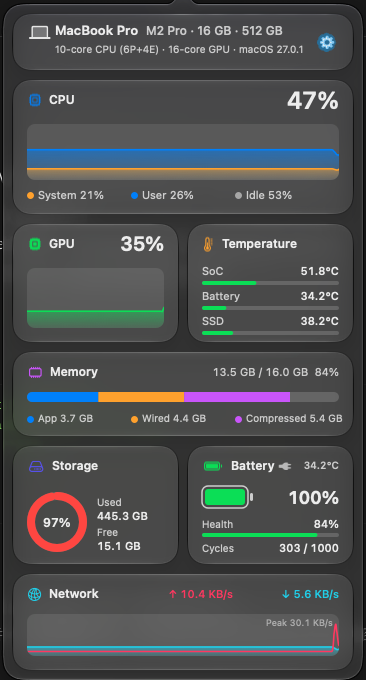
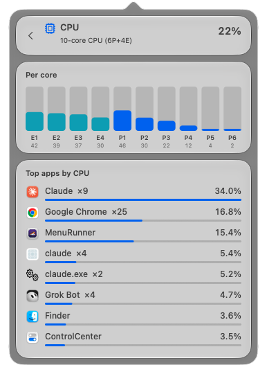
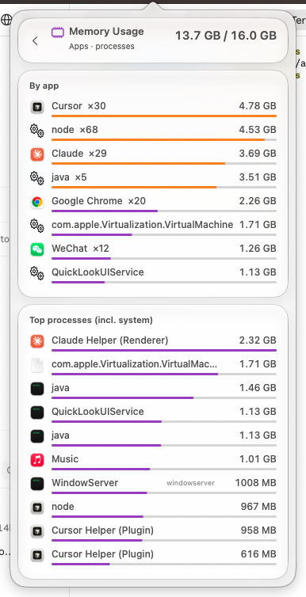
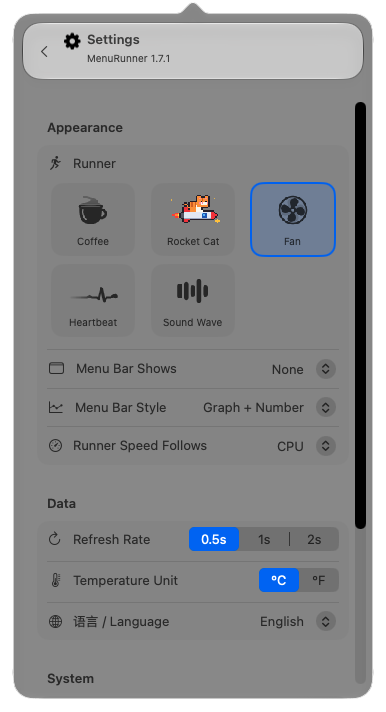
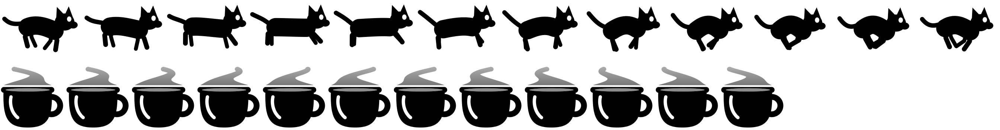

<div align="center">


# MenuRunner

**A tiny macOS menu bar runner + Liquid Glass system monitor**

[](README.md)
[](README.zh-CN.md)

[](https://github.com/HeadmasterEggy/MenuRunner/releases/latest)


&nbsp;&nbsp;&nbsp;&nbsp;






</div>

## Features

- **Runners** — a galloping cat, a steaming coffee cup a rainbow cat (our cat flying with a waving rainbow trail and twinkling stars) a monochrome pixel cat with a stepped stripe trail, a colour pixel-art Rocket Cat (an orange tabby riding a rocket with a flickering flame), plus smooth vector runners: a soaring bird, a colour goldfish blowing bubbles, a spinning fan, a scrolling heartbeat line and bouncing sound-wave bars — all original designs, drawn in code as template images that adapt to light / dark menu bars. Their speed follows CPU, GPU or memory usage.
- **Menu bar metrics with live mini graphs** — CPU, GPU, memory, battery, network, SoC or battery temperature. Choose *Graph + Number*, *Graph only* or *Number only*.
- **Liquid Glass panel** (`NSPopover` + `NSGlassEffectView`), animated at 60 fps:
  - Machine spec — model, chip, CPU / GPU cores, memory, disk, macOS version
  - CPU (System / User / Idle) and GPU history charts
  - Memory breakdown (App / Wired / Compressed)
  - Storage ring, battery level, health, cycle count and estimated time left (or time until full)
  - Temperatures — SoC, battery, SSD
  - Network upload / download speed
  - **Click any card for details** (with smooth slide / fade transitions) — app disk usage largest-first, per-core CPU and top apps by CPU, GPU utilization and top apps by GPU, memory by app, every temperature sensor, all volumes, full battery info (capacity, voltage, power, adapter), network interfaces and top apps by traffic, full machine spec
- **Settings** — refresh rate (0.5 s / 1 s / 2 s), °C / °F, English / 简体中文, launch at login, open Activity Monitor.

## Install

1. Download `MenuRunner-x.y.dmg` from [Releases](https://github.com/HeadmasterEggy/MenuRunner/releases/latest).
2. Open the DMG and drag **MenuRunner** into **Applications**.
3. The app is not notarized, so macOS blocks it on first launch. Either:
   - open **System Settings → Privacy & Security** and click **Open Anyway**, or
   - run `xattr -dr com.apple.quarantine /Applications/MenuRunner.app`

Left-click the menu bar icon to open the panel; right-click it (or use the gear button) for settings.

## Build from source

Requires macOS 26+ on Apple Silicon and the Xcode Command Line Tools.

```sh
./build.sh      # compile, ad-hoc sign, install to ~/Applications
./make_dmg.sh   # build dist/MenuRunner-<version>.dmg
```

Regenerate the app icon (`assets/AppIcon.icns`):

```sh
MenuRunner.app/Contents/MacOS/MenuRunner --icon /tmp/AppIcon.iconset
iconutil -c icns /tmp/AppIcon.iconset -o assets/AppIcon.icns
```


Debug helpers:

```sh
MenuRunner.app/Contents/MacOS/MenuRunner --stats            # print all readings
MenuRunner.app/Contents/MacOS/MenuRunner --preview out.png  # export runner frames
```

## Notes

- SoC / SSD temperatures come from the system HID temperature sensors through a private IOKit API (the same approach Stats and iStat use). No root needed, but future macOS versions may change it; the panel shows `--` when unavailable.
- Everything else uses public APIs: `host_statistics`, IORegistry, `getifaddrs` and IOKit power sources.
