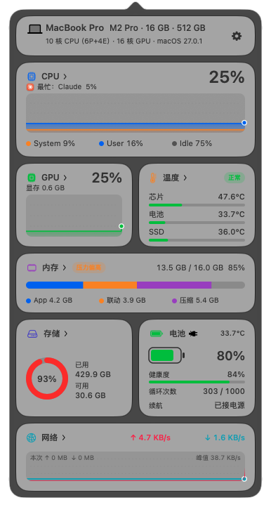
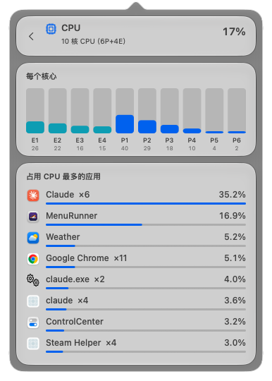
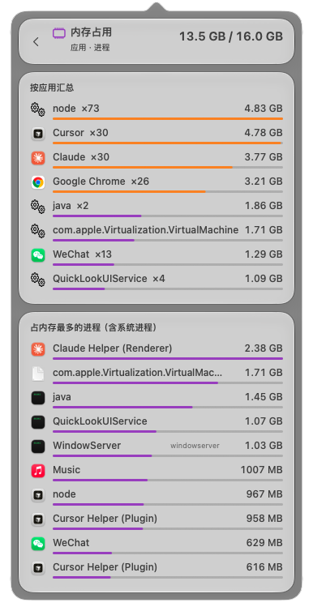
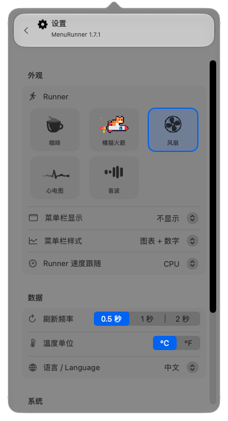
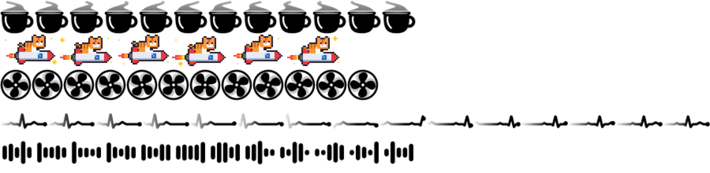

<div align="center">


# MenuRunner

**macOS 菜单栏小跑者 + 液态玻璃系统监控**

[](README.md)
[](README.zh-CN.md)

[](https://github.com/HeadmasterEggy/MenuRunner/releases/latest)


&nbsp;&nbsp;&nbsp;&nbsp;






</div>

## 功能

- **Runner**：冒热气的咖啡、彩色像素画「橘猫火箭」（橘猫骑着火箭，尾焰闪烁）、旋转风扇、滚动的心电图（CPU 越高滚得越快、心跳越密、峰越高）、跳动的音波，均为原创设计，用代码绘制；单色的是模板图，自动适配深浅色菜单栏；速度可以跟随 CPU、GPU 或内存占用。
- **菜单栏指标 + 动态小图**：CPU、GPU、内存、电池、网络、芯片或电池温度；可选「图表 + 数字」「仅图表」「仅数字」。
- **液态玻璃面板**（`NSPopover` + `NSGlassEffectView`），60fps 动画：
  - 本机配置：机型、芯片、CPU / GPU 核心数、内存、硬盘、系统版本
  - CPU（System / User / Idle）和 GPU 历史曲线
  - 内存细分（App / 联动 / 压缩）
  - 存储环形图、电量、电池健康度、循环次数、预计可用时间（充电时为充满还需）
  - 温度：芯片、电池、SSD
  - 网络上传 / 下载速度
  - **每张卡片都能点进去看细节**（平滑滑动 / 淡入切换）：各应用占用的磁盘空间（从大到小）、每个 CPU 核心和最占 CPU 的应用、GPU 利用率和最占 GPU 的应用、各应用内存、所有温度传感器、所有磁盘、完整电池信息（容量、电压、功率、适配器）、网卡和流量最大的应用、完整本机配置
- **设置**：刷新频率（0.5 / 1 / 2 秒）、°C / °F、简体中文 / English、开机自动启动、打开活动监视器。

## 安装

1. 在 [Releases](https://github.com/HeadmasterEggy/MenuRunner/releases/latest) 下载 `MenuRunner-x.y.dmg`。
2. 打开 DMG，把 **MenuRunner** 拖进 **应用程序**。
3. 应用没有经过 Apple 公证，第一次打开会被拦截。任选一种方式放行：
   - 打开 **系统设置 → 隐私与安全性**，点 **仍要打开**；或
   - 在终端运行 `xattr -dr com.apple.quarantine /Applications/MenuRunner.app`

左键点菜单栏图标打开面板；右键（或面板里的齿轮按钮）打开设置。

## 从源码构建

需要 Apple 芯片、macOS 26 以上，以及 Xcode 命令行工具。

```sh
./build.sh      # 编译、本地签名、安装到 ~/Applications
./make_dmg.sh   # 生成 dist/MenuRunner-<版本>.dmg
```

重新生成 app 图标（`assets/AppIcon.icns`）：

```sh
MenuRunner.app/Contents/MacOS/MenuRunner --icon /tmp/AppIcon.iconset
iconutil -c icns /tmp/AppIcon.iconset -o assets/AppIcon.icns
```


调试命令：

```sh
MenuRunner.app/Contents/MacOS/MenuRunner --stats            # 打印所有读数
MenuRunner.app/Contents/MacOS/MenuRunner --preview out.png  # 导出 runner 帧图
```

## 说明

- 芯片 / SSD 温度通过 IOKit 私有接口读取系统 HID 温度传感器（Stats、iStat 也是这样做的），不需要管理员权限，但未来 macOS 版本可能变化，读不到时面板显示 `--`。
- 其余数据都用公开接口：`host_statistics`、IORegistry、`getifaddrs`、IOKit 电源信息。
